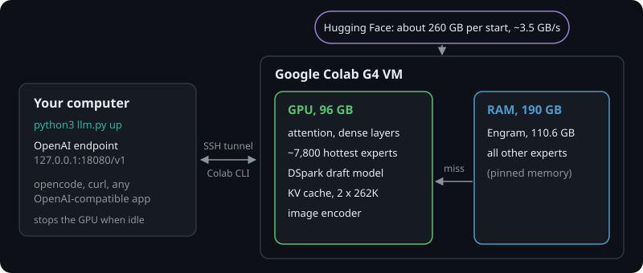
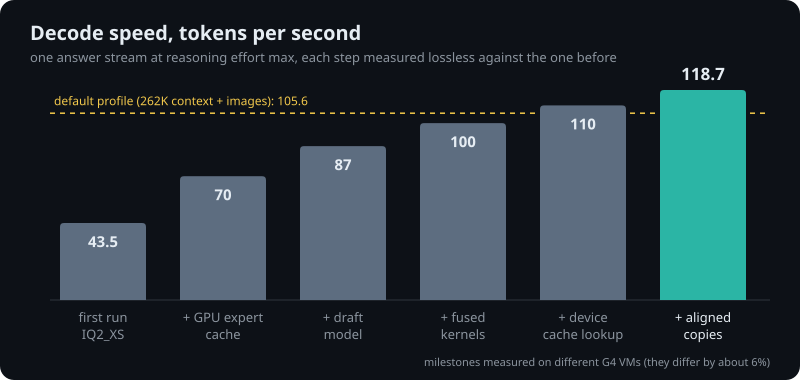

<div align="center">

<h1>DeepSeek V4.1 Flash on one Colab GPU</h1>

<p><b>The uncensored 249 GB model as your own OpenAI-compatible endpoint, at over 100 tokens a second.</b><br>
One command, one Google Colab G4, no server of your own.<br>
Runs on a Google AI Pro subscription: 200 compute units every month, about 9 per hour of use.</p>

https://github.com/user-attachments/assets/6ab03b08-6992-4fc6-8d6a-9c809c8c6336

</div>

## Quick start

You need a Google AI Pro subscription (200 Colab compute units a month) or Colab Pro (100 a month), Python 3.9 or newer and an SSH client. It runs on Linux, macOS and Windows (PowerShell or cmd; type `python` if `python3` is not found).

```bash
git clone https://github.com/leonxger/deepseek-colab.git deepseek-colab && cd deepseek-colab
python3 llm.py up
```

The first run offers to install Google's Colab CLI, walks you through the Google login and asks for a few defaults (image input, context size, reasoning effort, idle stop; Enter keeps each one). Then it starts a G4 GPU and shows each step until your endpoint is ready:

```text
Starting a Colab G4 GPU · about 4 minutes

   0:06  ✓  G4 GPU allocated
   0:12  ✓  image encoder downloaded (1 GB)
   0:19  ✓  draft model downloaded (8 GB)
   0:21  ✓  uncensored tensors downloaded (1.7 GB)
   0:55  ✓  model downloaded (138 GB)
   2:19  ✓  llama.cpp built
   2:34  ✓  model loaded onto the GPU
   2:41  ✓  RAM freed, cold experts pinned
   3:22  ✓  Engram table loaded (110 GB)
   3:23  ✓  warmup answer done

✓ Ready after 3:24

  Base URL   http://127.0.0.1:18080/v1
  API key    sk-ds41-3f9c...
  Models     ds41 (effort 50) · ds41-max (effort max)
  Context    262,144 tokens per request · image input on · about 105.6 tok/s

  Try it     python3 llm.py ask "Hello!"
  opencode   python3 llm.py opencode [project folder]
  Stop       python3 llm.py down

  ● GPU running   idle 2:13 · stops in 7:47   ran 6:31 · about 0.97 compute units
```

The last line stays live: GPU on or off, the countdown to the automatic stop, the cost so far. Paste the base URL and key into any OpenAI-compatible app: Open WebUI, the OpenAI SDKs, curl. `python3 llm.py opencode` starts opencode already connected, in any shell. After 10 minutes without requests the GPU stops by itself, and the next request starts it again. `python3 llm.py down` stops everything right away.

## What you get

| | Images on (default) | Text only, up to 131K (`--fast`) |
| --- | --- | --- |
| Decode speed | 105.6 tok/s | 118.7 tok/s |
| Context per request | 262,144 tokens | 131,072 tokens |
| Image input | yes | no |
| First token, 8K / 32K prompt | 9.9 / 27.8 s | 8.8 / 23.4 s |
| Follow-up turns (prompt cache) | about 1 s | about 1 s |

Image input and context size are separate settings. Text only up to 131K gets the faster memory layout; everything else runs at the left column's speed. Both serve two requests at a time, with tool calling and separate reasoning output. Speeds are the average of six fixed answers at reasoning effort max.

## What it costs

This project costs about **9 Colab compute units per hour** (8.9 measured) while the GPU runs.

| Plan | Compute units every month | GPU hours |
| --- | --- | --- |
| Google AI Pro | 200 | about 22 |
| Colab Pro | 100 | about 11 |

Each start spends about 4 minutes (about 0.6 units) on downloading and loading. When you're not using it, nothing runs and nothing is billed.

## How it works



- **The model.** ISTA-DASLab's 2-bit GSQ-RCO quantization of DeepSeek V4.1 Flash, which matched the original on their AIME, GPQA and LiveCodeBench runs. At every start, AtomicChat's 82 uncensored tensors are spliced in.
- **The memory trick.** Each token uses 6 of the 384 experts in a layer, and some experts are used far more than others. The hottest 7,800 live on the GPU. The rest wait in RAM and cross PCIe only on a miss.
- **The speed.** A small draft model guesses two tokens ahead and the big model checks both in one pass. On top of that, llama.cpp gets 22 patches: fused kernels, an expert cache that runs on the GPU, copies aligned to whole memory lines. Every one was checked to produce the same tokens as the build before it, within floating-point noise.



## Read next

- [SETUP.md](SETUP.md): every platform, settings, connecting apps, troubleshooting.
- [AGENT_START_HERE.md](AGENT_START_HERE.md): point your AI coding agent here and it can set things up and help you.
- [docs/how-it-works.md](docs/how-it-works.md): the memory layout, the boot sequence and every patch.

## Credits

Built on DeepSeek V4.1 Flash by DeepSeek, the GSQ-RCO GGUF by ISTA-DASLab, uncensored tensors by AtomicChat, the DSpark draft GGUF by unsloth, llama.cpp by ggml-org and Google's Colab CLI. The model files come straight from their Hugging Face pages, under their licenses.

Uncensored means the model refuses less often. What you do with it is up to you.

## What's next

DeepSeek V4.1 Flash is the first model. More models are planned, each tuned for Colab the same way, so that this repo becomes a hub: pick a model at the start, run `up`, and get fast inference from the same optimized kernels and memory layout.
